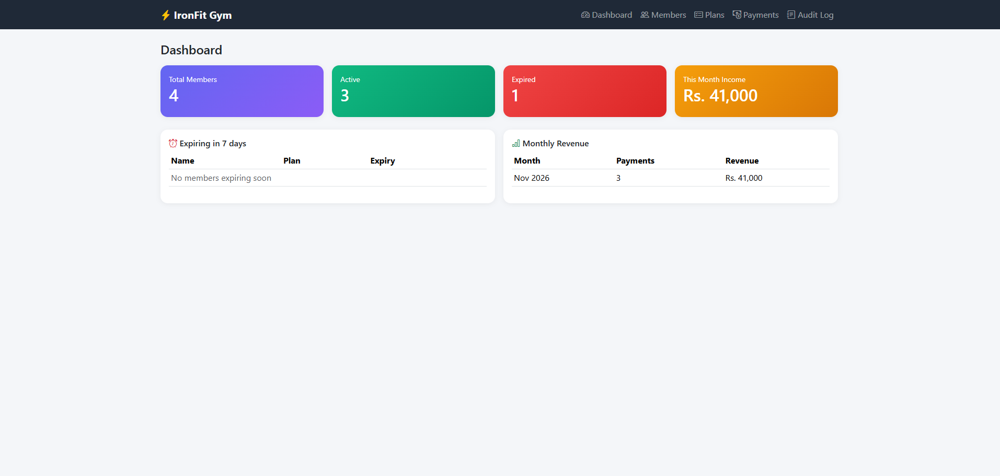
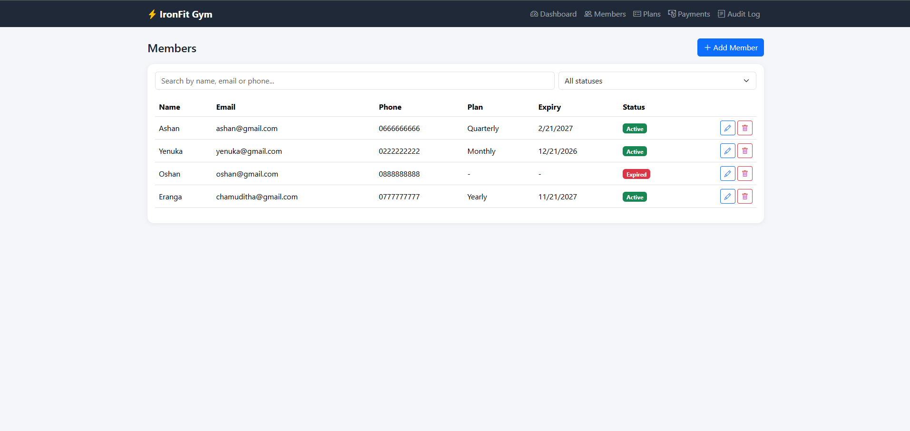
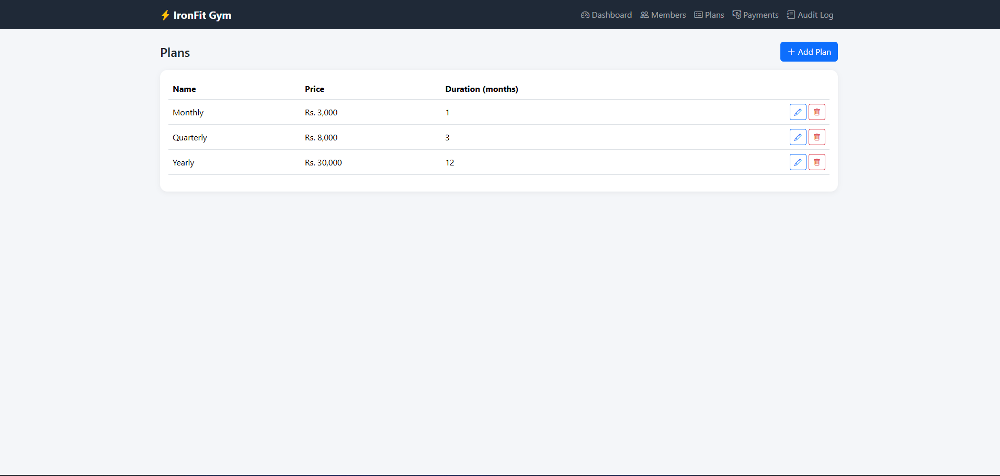
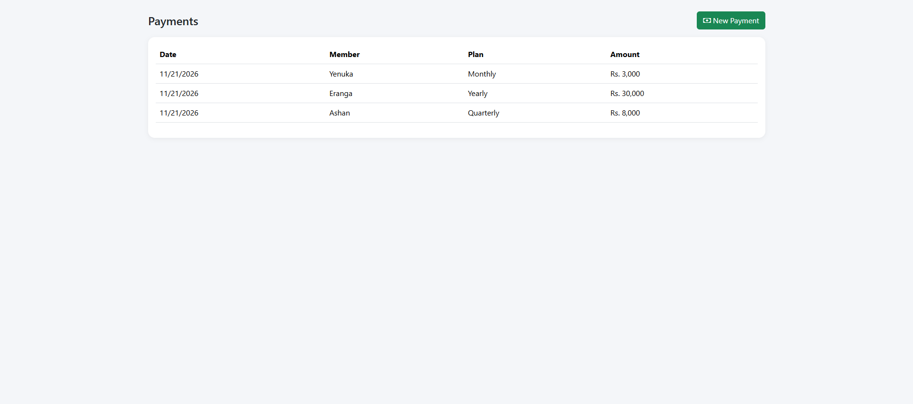
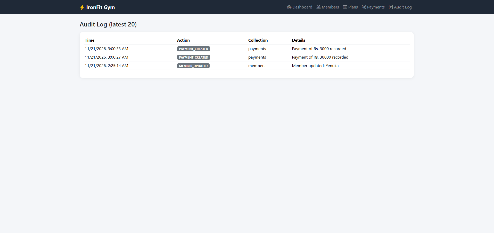
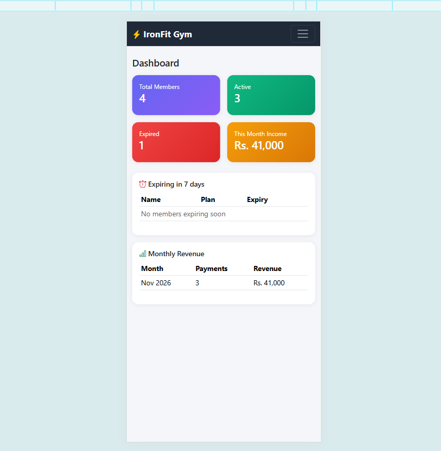
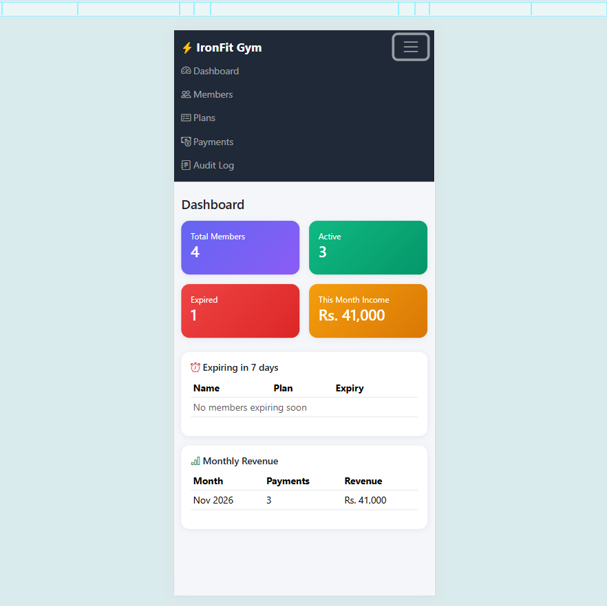

# 🏋️ IronFit Gym Membership System

A responsive web application for managing gym members, membership plans and payments, built with **MongoDB, Express, Node.js** and **Bootstrap 5**.

## ✨ Features

- Full CRUD for Members and Plans
- Payment processing with automatic membership renewal
- **Database triggers** (Mongoose middleware) that:
  - set the payment amount from the selected plan
  - extend the member's expiry date and activate the membership
  - write entries to an audit log
- **Stored-procedure equivalents** using MongoDB aggregation pipelines:
  - dashboard summary
  - members expiring within 7 days
  - monthly revenue report
- Search and status filter for members
- Audit log viewer
- Fully responsive UI

## 🛠️ Tech Stack

| Layer | Technology |
|---|---|
| Database | MongoDB |
| Backend | Node.js, Express, Mongoose |
| Frontend | HTML, JavaScript, Bootstrap 5 |

## 🗂️ Database Design

| Collection | Fields |
|---|---|
| plans | name, price, durationMonths |
| members | name, email, phone, plan (ref), joinDate, expiryDate, status |
| payments | member (ref), plan (ref), amount, paymentDate |
| auditlogs | action, collectionName, documentId, details, timestamp |

## 🚀 Getting Started

### Prerequisites
- Node.js (LTS)
- MongoDB Community Server running locally

### Installation

```bash
git clone https://github.com/Sathmira23/gym-membership-system.git
cd gym-membership-system
npm install
```

Create a `.env` file (see `.env.example`):

```
MONGO_URI=mongodb://127.0.0.1:27017/gymdb
PORT=3000
```

Run the app:

```bash
npm run dev
```

Open http://localhost:3000


## 📸 Screenshots

### Dashboard


### Members (search & filter)


### Plans


### Payments


### Audit Log (written by triggers)


### Responsive (mobile view)




## 👤 Author

**Sathmirra Jayawardhana**: [GitHub](https://github.com/Sathmira23) | [LinkedIn](https://www.linkedin.com/in/sathmira-jayawardhana)